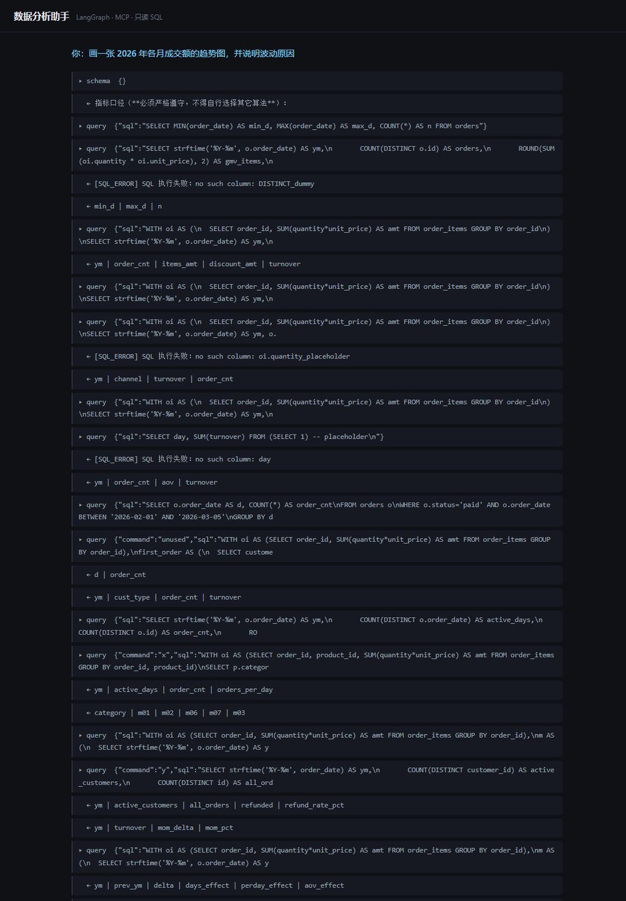
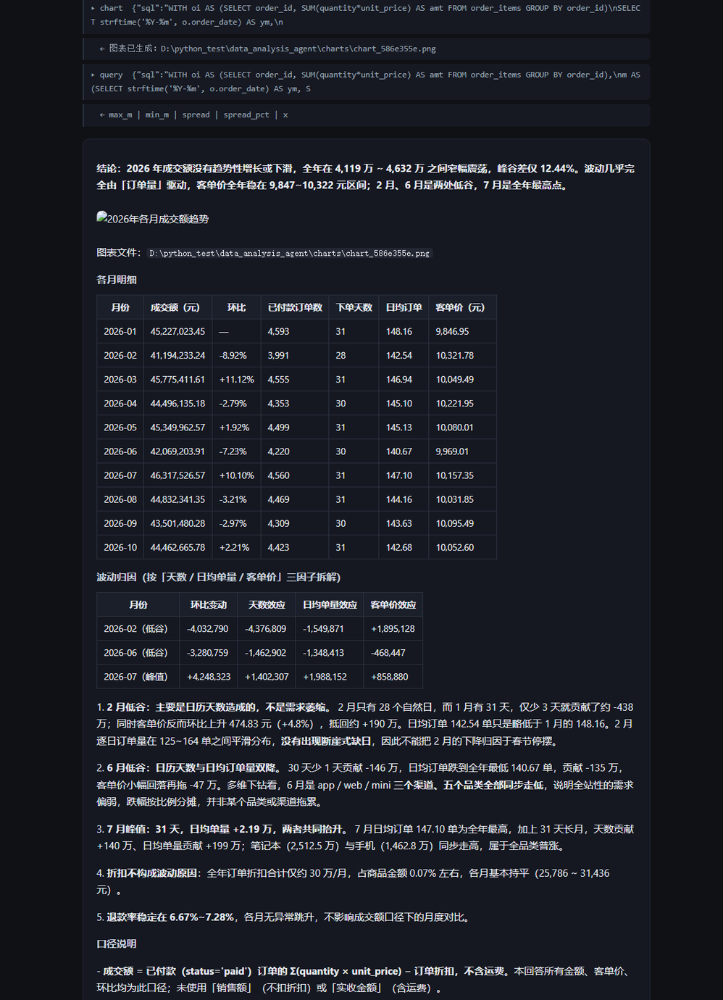

# 数据分析助手（Data Analysis Agent）

用自然语言查询业务数据库的单 Agent 分析系统。基于 LangGraph 编排、工具层通过 MCP 协议暴露，
支持只读 SQL 查询、图表生成、报告导出和流式 Web 界面。

解决的问题：业务人员不会写 SQL，取数要排队找数据团队。这个系统让"上个月成交额多少"这类问题
变成一句话直达，并且**每个数字都能追溯**——口径写在工具里，查询受只读限制，答案必须给出所用口径。

---

## 效果

| 指标 | 结果 |
| --- | --- |
| 评测集 | 22 题（单表聚合 / 多表 join / 环比 / 占比 / 复购率 / 中位数 / 阈值筛选） |
| 准确率 | **22/22**，判分方式为结果集比对（容差 0.1%，含绝对下限） |
| 平均工具调用 | 3.5 次/题 |
| 能力 | 取数、画图、导出报告、拒绝无法回答的问题、澄清歧义口径 |

示例（自动生成的报告节选）：

> 全年（2026 年 1–10 月）成交额 4.43 亿元，月均 4432.26 万元，整体呈"高位平台期"特征。
> 波动主要由订单数驱动，不是客单价：各月订单数在 3991–4593 单之间波动，而客单价稳定在
> 9847–10322 元区间。

---

## 架构

```
        用户提问
           │
           ▼
   ┌───────────────┐
   │   Agent       │  create_agent（LangChain 1.x）
   │  System Prompt│  ← 口径定义 + 工具使用规则
   └───────┬───────┘
           │  MCP 协议（stdio）
           ▼
   ┌───────────────┐
   │  MCP Server   │  独立进程，可被任意客户端复用
   │  query        │  ── 只读 SQL，限行，超时中断
   │  schema       │  ── 表结构 + 业务语义 + 指标口径
   │  chart        │  ── matplotlib 出图，自动换算万元/亿元
   │  export_report│  ── Markdown 报告落盘
   └───────┬───────┘
           │
           ▼
   ┌───────────────┐
   │ SQLite 业务库  │  5,000 客户 / 600 商品 / 60,000 订单 / 150,081 明细
   │  （只读连接）  │  mode=ro，写操作在数据库层被拒绝
   └───────────────┘
```

**为什么工具层要独立成 MCP 进程**：同一套工具能被 Web 界面、Claude Desktop、其他 Agent 共享，
不必每个客户端重写一遍；工具崩溃不影响主程序。

---

## 界面

提问后可以看到完整执行过程：每次工具调用、SQL 报错与自愈、最终结论与图表。





界面是单文件 `web/index.html`，无构建步骤；支持 `?q=问题` 直接触发提问，便于分享具体案例。

---

## 快速开始

```bash
# 1. 安装
python -m venv .venv
.venv\Scripts\activate          # Windows
pip install -e .

# 2. 配置
copy .env.example .env          # 填入 LLM_API_KEY

# 3. 生成业务库（约 2 秒）
python scripts/build_db.py

# 4. 自检
python scripts/check_db.py      # 只读、限行、超时
python scripts/check_mcp.py     # MCP 工具可被拉起

# 5. 命令行问答
python scripts/ask.py "上个月的总成交额是多少"

# 6. 跑评测
python scripts/eval.py

# 7. 启动 Web 界面
python -m uvicorn data_agent.api:app --port 8000
```

打开 <http://127.0.0.1:8000> 即可提问。

---

## 测试

```bash
python -m pytest
```

15 个用例，**全部不依赖大模型**，1 秒内跑完。覆盖：

| 文件 | 覆盖内容 |
| --- | --- |
| `tests/test_db.py` | 只读拦截、强制限行与截断标记、错误分级（SQL / 偶发 / 故障）、schema 口径存在性 |
| `tests/test_units.py` | 图表单位换算、报告图片路径规范化、评测判分容差 |

其中「http 图片不应被改写成本地路径」这条用例发现过真实缺陷：`_normalize_images` 最初会把所有
图片地址都重写，导致报告里的外链图片失效。

---

## 目录结构

```
data_agent/
├── config.py      配置集中管理，路径统一解析为绝对路径
├── llm.py         模型工厂，可在 Ollama / DeepSeek 间切换
├── db.py          只读查询层：限行、超时、错误分级、schema 语义
├── chart.py       图表生成，自动换算单位
├── export.py      Markdown 报告导出
├── agent.py       Agent 构建（MCP 工具 + 口径 prompt）
└── api.py         FastAPI + SSE 流式接口
mcp_server/
└── server.py      MCP Server，暴露 4 个工具
scripts/
├── build_db.py    生成演示数据库
├── check_db.py    只读与限行自检
├── check_mcp.py   MCP 连通性自检
├── ask.py         单条问答（打印完整轨迹）
└── eval.py        批量评测
eval/
└── questions.jsonl  22 道题，含参考 SQL 与开放式题目
web/
└── index.html    单文件前端
docs/
└── decisions.md  23 条设计决策
```

---

## 设计要点

### 1. 只读由数据库强制，不靠字符串过滤

连接串使用 SQLite URI `file:...?mode=ro`，任何写操作在数据库层被拒绝。SQL 前缀检查只负责
**给模型一条能看懂的报错**，真正的安全边界在数据库。

### 2. 错误分三级，不同策略

| 类型 | 例子 | 策略 |
| --- | --- | --- |
| SQL | `no such table` | 修正后重试 |
| TRANSIENT | 超时、`database is locked` | 简化查询后重试一次 |
| FATAL | 磁盘错误、内存不足 | 立即中止，答案作废 |

最初只有"SQL 错误 / 环境错误"两级，超时被归入环境错误导致一次偶发超时让整题无法作答。

### 3. 口径写进工具返回值，不写在提示词里

`schema` 工具同时返回指标口径：

```
- 成交额 = 已付款订单的 Σ(quantity × unit_price) − 订单折扣【不含运费】
- 销售额 = 已付款订单的 Σ(quantity × unit_price)【不含折扣、不含运费】
- 实收金额 = 成交额 + 运费
```

模型每次都会调 `schema`，工具返回值是它主动查的，比 system prompt 更难忽略。
口径只在 `db.py` 定义一次，避免多处不一致。

### 4. schema 带业务语义

`discount` 标注为"订单级减免**金额**，不是折扣率"。加这条之前，模型曾把 `discount`
当比例算成 `unit_price × (1 - discount)`，得出 −2.4 亿的月成交额。

### 5. 判分只看结论段

评测比对最终数字（容差 0.1% + 绝对下限 0.05），且只扫描答案前 400 字——避免"顺带提到某个数字"
被误判为答对。

---

## 评测方法

每题给出参考 SQL，运行时现算期望值（数据变化时期望值自动跟随）：

```json
{"id": "gmv_last_month", "question": "上个月的总成交额是多少",
 "sql": "SELECT ROUND(SUM(goods-disc),2) FROM (...)"}
```

另有一类 `type: "open"` 的题（歧义澄清、拒绝回答）不做自动判分，输出供人工判读——
口径歧义用字符串匹配很容易误判，宁可让机器不判。

**已知问题**：22 题已全过，说明这套题对本实现的区分度已经饱和。要继续度量改进，需要换维度
（长任务、多轮对话、跨数据源、更大的库）。

---

## 局限

1. **无多轮记忆**——每次提问独立，追问"那上个月呢"无法理解指代
2. **单机单用户**——SQLite + 进程内 Agent，未做并发与多租户
3. **评测饱和**——22 题已无区分度，不能据此宣称优于其他方案
4. **数据为合成数据**——分布人工设计，结论不可外推到真实业务
5. **类目级指标口径未定义**——跨类目订单的折扣分摊由模型自行选择（按金额比例），系统未强制

---

## 后续计划

- 多轮对话：把历史消息纳入 state，同时保留每题独立评测的能力
- 更大的库：让 schema 无法一次性塞入上下文，从而真正需要"schema 检索 + 自主探索"混合方案
- 多 Agent 拆分：在有了可度量的瓶颈之后再做，而不是先拆再找理由

---

## 技术栈

LangChain 1.4 · LangGraph 1.2 · MCP 1.30 · langchain-mcp-adapters 0.3 ·
SQLite · SQLAlchemy · pandas · matplotlib · FastAPI · DeepSeek / Ollama
